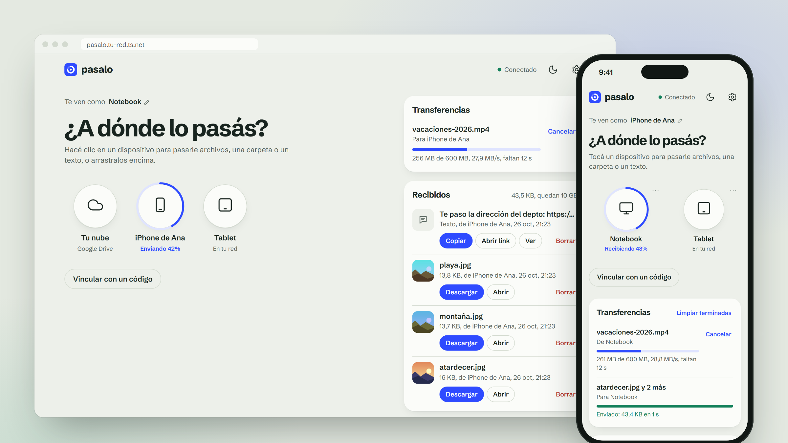
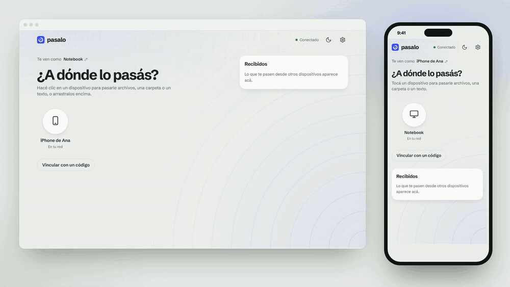
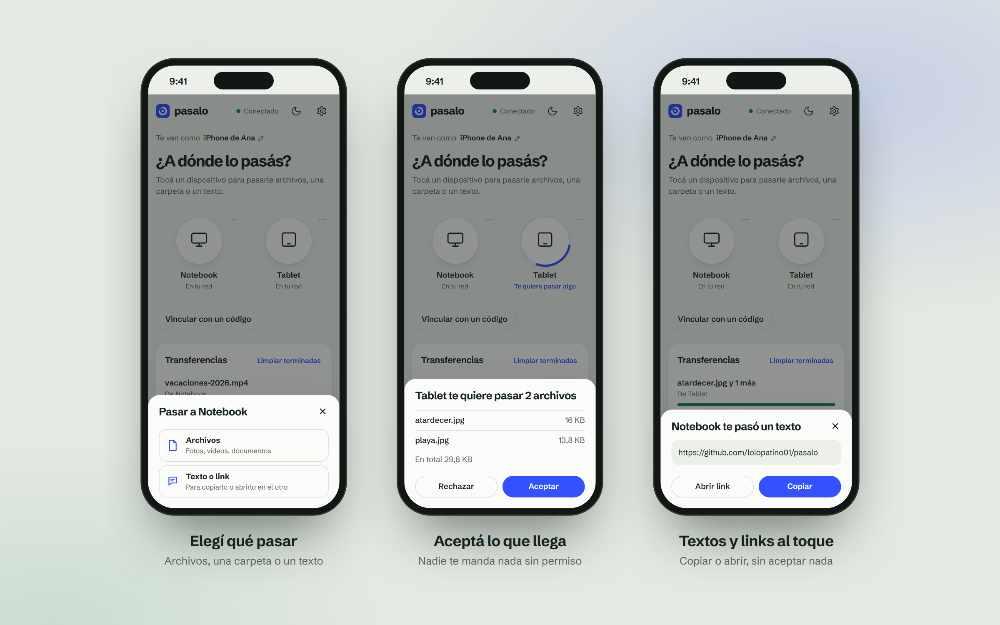
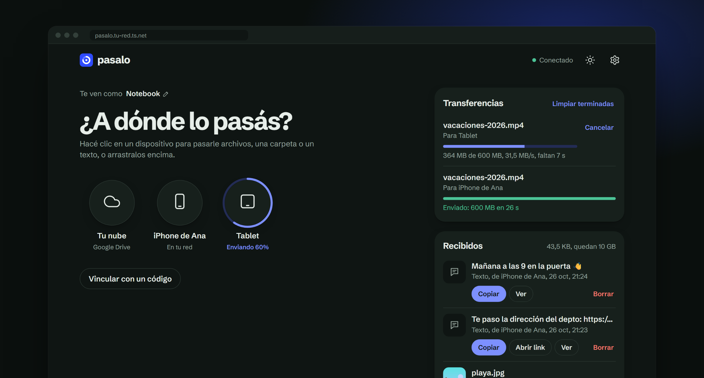
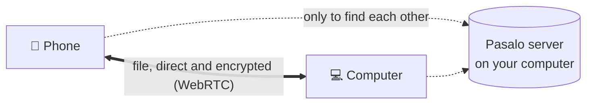

<div align="center">


# Pasalo

**Send files, folders and text directly between your devices.**<br>
Computer, iPhone, Android and tablet, in any direction. No cables, nothing to install, and nothing goes through a server.

<sub><a href="README.md">Español</a> · <b>English</b></sub>

[](https://github.com/lolopatino01/pasalo/actions/workflows/ci.yml)
[](LICENSE)
[](#installation)
[](#how-it-works)
[](#development)
[](https://nodejs.org)
[](https://github.com/lolopatino01/pasalo/stargazers)

**[⬇ Download for Windows](https://github.com/lolopatino01/pasalo/releases/latest/download/Pasalo-windows.zip)** · [Try it in 2 minutes](#try-it-in-2-minutes)

[How it works](#how-it-works) · [Installation](#installation) · [From your phone](#using-it-from-phones-and-tablets) · [Your cloud](#your-cloud-google-drive) · [Privacy](#privacy-and-security)

<br>



<sub>Screenshots show the Spanish interface; the app switches to English automatically when your browser is in English.</sub>

</div>

## Try it in 2 minutes

**Windows:** download [**Pasalo-windows.zip**](https://github.com/lolopatino01/pasalo/releases/latest/download/Pasalo-windows.zip),
unzip it and double-click `iniciar-pasalo.bat`. It comes prebuilt; if you don't have Node.js, it installs it for you.

**Linux, macOS or Windows with Node.js 22.12+:**

```bash
git clone https://github.com/lolopatino01/pasalo.git && cd pasalo
npm install && npm run build && npm start
```

It opens at `http://localhost:3000`. On your phone, open the address shown in the window
(`http://computer-IP:3000`, on the same wifi), tap the other device and choose what to send.
More in [Installation](#installation).

## Why Pasalo?

Moving a photo from your computer to your phone shouldn’t mean messaging it to yourself on WhatsApp. AirDrop solves
that, but only between Apple devices. Pasalo does the same for **any device with a browser**, and files travel
**directly** from one to the other.

| | **Pasalo** | AirDrop | WhatsApp | Uploading to the cloud |
|---|:---:|:---:|:---:|:---:|
| iPhone ↔ Android ↔ Windows | ✅ | ❌ Apple only | ✅ | ✅ |
| Files of several GB | ✅ | ✅ | ❌ up to 2 GB | ⚠️ uses your storage |
| Photos and videos in original quality | ✅ | ✅ | ⚠️ compresses them | ✅ |
| No third-party servers in between | ✅ | ✅ | ❌ | ❌ |
| Whole folders | ✅ | ✅ | ❌ | ✅ |
| No app to install | ✅ | ✅ | ❌ | ⚠️ |

## In action

<div align="center">

</div>

## Features

- **Finds devices on your Wi-Fi by itself.** Tap one, choose what to send, done.
- **Any device to any other**, whoever owns it: devices on other networks are paired once with a 6-digit code.
- **Files of any size**, from a photo to a multi-GB video. The receiver has to accept.
- **Whole folders** without zipping them first: they arrive as a zip built on the fly, subfolders included.
- **Text and links**: type or paste something and it pops up on the other device, ready to copy or open.
- **Writes to disk as it arrives** (Chrome, Edge, Android and Safari on iOS 26+), so memory never fills up.
- **Live progress**: a ring around each device, with speed, time left and cancel.
- **Received** items stay in the app until you delete them: Download, Open and Share (on phones, to Photos or Files).
- **Your cloud** (optional): everyone can connect their own Google Drive to keep things at hand on all their devices,
  download them or send them to another device.
- **Installs** like any other app, shows up in Android’s **Share** menu, has a **dark mode** and updates itself.
- **English or Spanish**, following your browser’s language (you can change it in Settings).

<div align="center">

<br><br>

</div>

## How it works



1. A computer at home runs the **Pasalo server** (Node.js). It serves the app and introduces devices to each other.
2. Each device opens the app in the browser and connects to the server.
3. To send a file, both devices set up a **direct connection** (WebRTC, encrypted with DTLS) and the file travels over
   it. The server never sees it.
4. If a direct connection can’t be made (some firewalls or networks block it), the file goes **through the server**,
   which is your own computer, without being stored anywhere.
5. **Your cloud** is separate: the browser uploads straight to Google Drive with each person’s permission. The Pasalo
   server never touches those files.

## Privacy and security

- **Files are never stored on a server.** They go from one device to the other, and what you receive stays only on the device that received it.
- **Who can see you:** only devices that reach your server (your Wi-Fi or your Tailscale network) and the ones you paired
  with a code. Nobody can send you a file without your approval.
- **Google Drive:** Pasalo asks for the `drive.file` permission, which only lets it see and touch **the files Pasalo
  uploaded**, never the rest of your Drive. The permission is stored only in your browser, lasts one hour, and you can
  revoke it anytime from Settings or from [your Google account](https://myaccount.google.com/permissions).
- **No personal data or keys in the code.** Your Google ID goes in a `.env` file that is never committed.
- **Don’t expose it to the open internet** (for example, with a public tunnel): anyone with the address would see your
  device names and could send you requests. To use it away from home, use Tailscale (below).

## Installation

You need a computer that stays on while Pasalo is in use.

### On Windows (easiest)

1. Download [**Pasalo-windows.zip**](https://github.com/lolopatino01/pasalo/releases/latest/download/Pasalo-windows.zip)
   from the latest version in [Releases](https://github.com/lolopatino01/pasalo/releases) and unzip it.
   It comes prebuilt. If you want the code to modify it, use `git clone` (the .bat builds it on start).
2. Double-click **`iniciar-pasalo.bat`**. The first time, it installs Node.js if missing.
   If Windows asks about the firewall, allow access on **private networks**.
3. Pasalo opens in your browser. The black window shows the addresses to open it from your other devices.
   Keep it open while you use it; **`detener-pasalo.bat`** stops it.
4. Optional: in **Settings → Start with Windows** (only shown on the computer running Pasalo) choose **On**
   and it starts on its own every time the computer starts, without opening any window.

### On any system (Linux, macOS, Windows)

With [Node.js](https://nodejs.org) 22.12 or newer:

```bash
npm install
npm run build
npm start
```

Open `http://localhost:3000`.

## Using it from phones and tablets

### On your home Wi-Fi

With the phone on the same Wi-Fi as the computer, open the address the computer shows when it starts
(something like `http://192.168.1.20:3000`). You can start sending files right away.

Over `http`, browsers don’t let you **install** the app or **save to disk** (received files go to memory, fine for photos
and documents). For that you need `https`:

### With https and from anywhere: Tailscale (recommended)

[Tailscale](https://tailscale.com) creates a free private network between your devices. It gives you `https` with a
valid certificate and Pasalo works away from home too, without being exposed to the internet.

1. Create a Tailscale account and install the app on the computer and on each phone or tablet, with the same account.
2. In the [Tailscale admin panel](https://login.tailscale.com/admin/dns), under **DNS**, enable **MagicDNS** and **HTTPS Certificates**.
3. In the panel, under **Machines**, open the computer’s menu and choose **Disable key expiry**, so it doesn’t disconnect every few months.
4. Start Pasalo. On Windows, `iniciar-pasalo.bat` opens Tailscale and publishes Pasalo by itself; on other systems run once:
   ```bash
   tailscale serve --bg 3000
   ```
5. When it starts, Pasalo shows the address: `https://your-computer.your-tailnet.ts.net`. Open it on your phone and
   **install the app** (Android: menu → Install app; iPhone: Share → Add to Home Screen).

> On Windows, the Tailscale app (the icon next to the clock) must be running: if you quit it, the `https` address stops
> working. `iniciar-pasalo.bat` opens it when needed.

**For your family:** each person installs Tailscale with **their own account**, and you share **only the computer** with
them from the panel (computer’s menu → **Share**). That way they reach Pasalo and nothing else on your network.

> Opening Pasalo over the `http` address and the `https` one counts as two different apps for the browser: the device
> shows up as new and with different received files. Pick one and stick to it.

## Pairing devices on other networks

Devices on your Wi-Fi show up by themselves. For one on another network that can still reach your server (for example,
over Tailscale from another house): tap **Pair with a code** on both. One shows a 6-digit code (valid for 5 minutes) and
the other types it in. You only do it once.

## Your cloud (Google Drive)

Optional. Each person connects **their own** Google Drive and uses **their own** space: the "Your cloud" circle uploads
to a "Pasalo" folder and the "Your cloud" panel lists what was uploaded, on all their devices. Uploads go in chunks and
resume if the internet drops. Tapping the circle also offers **Download from your cloud**, which takes you to the list.
On each file:

- **Download**: brings it to Received on that device (to disk, like anything sent to you).
- **Send to…**: tap another device, even someone else’s, and it gets sent while being downloaded in chunks, without storing it on yours.
- **Delete**: moves it to the Drive trash.

To enable it you need a free Google **client ID**. You only get it once (about 10 minutes):

1. **Project.** Go to [Google Cloud](https://console.cloud.google.com/projectcreate) and create a project called `Pasalo`.
2. **API.** Enable the [Google Drive API](https://console.cloud.google.com/apis/library/drive.googleapis.com) in that project.
3. **Consent screen.** In [Google Auth Platform](https://console.cloud.google.com/auth/overview), click **Get started**:
   - App name `Pasalo`, your support and contact email, **External** audience.
   - Under **Audience → Test users**, add the email of each person who will use it. Only those accounts can connect.
   - Under **Data access → Add or remove scopes**, check `.../auth/drive.file` and save.
   - Leave the app in **Testing** mode: no Google verification needed.
4. **Client.** Under **Clients → Create client**, type **Web application**. Under **Authorized JavaScript origins**, add
   every address Pasalo is opened from, for example:
   - `https://your-computer.your-tailnet.ts.net`
   - `http://localhost:3000`

   Leave redirect URIs empty. You don’t need the client secret.
5. **Configure it.** Create a `.env` file in the project folder with the client ID and restart Pasalo:
   ```
   GOOGLE_CLIENT_ID=123456789-abc.apps.googleusercontent.com
   ```

When connecting, Google warns "Google hasn’t verified this app": that’s normal in testing mode, click **Continue**. If it
says `origin_mismatch`, the address isn’t in the authorized origins (or Google hasn’t picked it up yet: wait a few minutes).

Without `GOOGLE_CLIENT_ID`, "Your cloud" doesn’t appear. It needs `https` or `localhost`: Google won’t connect over `http://192.168...`.

## Configuration

Environment variables, or a `.env` file in the project folder (one per line, `NAME=value`):

| Variable | Default | Purpose |
|---|---|---|
| `PORT` | `3000` | Port |
| `HOST` | `0.0.0.0` | Interface to listen on |
| `GOOGLE_CLIENT_ID` | empty | Enables "Your cloud" (see above) |
| `TRUST_PROXY` | off | `1` to trust `X-Forwarded-For` from a proxy on another machine |
| `STUN_URLS` | Google and Cloudflare | STUN servers, comma-separated |
| `TURN_URL`, `TURN_USERNAME`, `TURN_CREDENTIAL` | empty | Optional TURN server, for networks that block direct connections |
| `SSL_CERT`, `SSL_KEY` | empty | Paths to a certificate to serve `https` directly |

### On a server (Raspberry Pi, VPS)

```bash
docker build -t pasalo .
docker run -d --restart unless-stopped -p 3000:3000 -e GOOGLE_CLIENT_ID=... pasalo
```

If it sits behind a proxy on another machine, add `-e TRUST_PROXY=1` so the server sees each device’s real IP and
groups "your network" correctly.

## Troubleshooting

The server logs what happens in the black window (and in `servidor.log` if you use `iniciar-pasalo.bat`):

| You see | What it means | What to do |
|---|---|---|
| Nothing shows up when opening the page | The request doesn’t reach the computer | Make sure both are on the same Wi-Fi (not a guest network) or that Tailscale is connected. On iPhone with Chrome or Brave, enable **Local Network** in Settings → the app |
| `[pidió https]` | The browser tried `https://` on the Wi-Fi address | Type the address with `http://` in front, or use the Tailscale one |
| `[conexión directa falló]` | The direct connection failed and the server relay was used | It still works, a bit slower. If it always happens, check the Windows firewall |
| The `https` address doesn’t load | Tailscale isn’t connected | Open the Tailscale app on the computer and check it says *Connected* |
| With Tailscale on, the phone or tablet loses internet | Your Tailscale network has no DNS servers (common on Android) | In the [DNS panel](https://login.tailscale.com/admin/dns): **Add nameserver → Cloudflare** and enable **Override DNS servers**. Then turn the VPN off and on |

## Known limitations

- Both devices need to have Pasalo open at the same time.
- On iPhones with iOS older than 26, received files go to memory: fine for photos and documents, not for multi-GB files.
- If the phone locks or switches apps, the system may cut the transfer.
- On iPhone you can’t pick folders (iOS doesn’t allow it from the browser). On a computer you can pick or drag them.
- The Google Drive permission lasts one hour: if it expires halfway through downloading or sending a very large file
  from the cloud, it stops and you need to tap "Your cloud" again. Uploads don’t stop.

## Development

| Part | Technology |
|---|---|
| App | TypeScript + Vite, no framework (≈30 KB compressed) |
| Server | Node.js + `ws` |
| Transfer | WebRTC DataChannel, with a WebSocket relay as fallback |
| Storage | OPFS (Origin Private File System), writes to disk as it arrives |
| Cloud | Google Identity Services + Drive API v3 (resumable upload) |
| Language | Spanish and English, no libraries: dictionary in `src/i18n.ts` |

The sender never gets more than 16 MB ahead of what the receiver confirmed as written, so a slow phone doesn’t run out of memory.

```bash
npm run dev        # server with live reload
npm run check      # types (tsc --noEmit)
npm run build      # builds to dist/
```

**Tests.** `tests/e2e.mjs` opens two browsers with Playwright and tests a 300 MB file (verified with SHA-256),
declining, canceling, reloading, pairing with a code, removing devices, the theme, text and links, folders, English and
switching languages, and "Your cloud" (with a simulated Google Drive: upload, download and send to another device).
They run on GitHub on every change, over a direct connection and through the server:

```bash
npm i --no-save playwright && npx playwright install chromium
GOOGLE_CLIENT_ID= PORT=3100 npm start        # in another terminal, without your Google ID
npm run test:e2e           # RELAY=1 npm run test:e2e forces the server relay
```

## Contributing

Found a bug or have an idea? Open an [issue](https://github.com/lolopatino01/pasalo/issues) or send a pull request.
Before sending changes, run `npm run check`, `npm run build` and the tests (see [Development](#development)).
Interface texts are written in Spanish; if you add one, add its English translation in `src/i18n.ts`.

If Pasalo is useful to you, **give it a ⭐**: it helps more people find it.

## License

[MIT](LICENSE): use it, modify it and share it freely.
