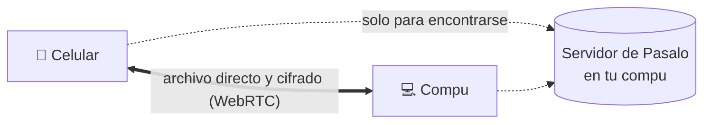

<div align="center">


# Pasalo

**Pasá archivos, carpetas y textos directo entre tus dispositivos.**<br>
Compu, iPhone, Android y tablet, en cualquier dirección. Sin cables, sin instalar nada y sin pasar por ningún servidor.

<sub><b>Español</b> · <a href="README.en.md">English</a></sub>

[](https://github.com/lolopatino01/pasalo/actions/workflows/ci.yml)
[](LICENSE)
[](#instalación)
[](#cómo-funciona)
[](#desarrollo)
[](https://nodejs.org)
[](https://github.com/lolopatino01/pasalo/stargazers)

**[⬇ Descargar para Windows](https://github.com/lolopatino01/pasalo/releases/latest/download/Pasalo-windows.zip)** · [Probalo en 2 minutos](#probalo-en-2-minutos)

[Cómo funciona](#cómo-funciona) · [Instalación](#instalación) · [Desde el celular](#usarlo-desde-el-celular-y-la-tablet) · [Tu nube](#tu-nube-google-drive) · [Privacidad](#privacidad-y-seguridad)

<br>


</div>

## Probalo en 2 minutos

**Windows:** bajá [**Pasalo-windows.zip**](https://github.com/lolopatino01/pasalo/releases/latest/download/Pasalo-windows.zip),
descomprimilo y hacé doble clic en `iniciar-pasalo.bat`. Viene armado; si no tenés Node.js, lo instala solo.

**Linux, macOS o Windows con Node.js 22.12+:**

```bash
git clone https://github.com/lolopatino01/pasalo.git && cd pasalo
npm install && npm run build && npm start
```

Se abre en `http://localhost:3000`. Desde el celular, abrí la dirección que muestra la ventana
(`http://IP-de-la-compu:3000`, con la misma wifi), tocá el otro dispositivo y elegí qué pasarle.
Más detalles en [Instalación](#instalación).

## ¿Por qué Pasalo?

Pasar una foto de la compu al celular no debería ser mandártela por WhatsApp. AirDrop resuelve eso, pero solo entre
equipos de Apple. Pasalo es lo mismo para **cualquier dispositivo con navegador**, y los archivos van **directo** de uno
al otro.

| | **Pasalo** | AirDrop | WhatsApp | Subirlo a la nube |
|---|:---:|:---:|:---:|:---:|
| iPhone ↔ Android ↔ Windows | ✅ | ❌ solo Apple | ✅ | ✅ |
| Archivos de varios GB | ✅ | ✅ | ❌ hasta 2 GB | ⚠️ ocupa tu espacio |
| Fotos y videos en calidad original | ✅ | ✅ | ⚠️ los comprime | ✅ |
| Sin pasar por servidores de terceros | ✅ | ✅ | ❌ | ❌ |
| Carpetas enteras | ✅ | ✅ | ❌ | ✅ |
| Sin instalar ninguna app | ✅ | ✅ | ❌ | ⚠️ |

## En acción

<div align="center">

</div>

## Qué hace

- **Encuentra solos** los dispositivos de tu misma wifi. Tocás uno, elegís qué pasarle y listo.
- **Cualquier dispositivo con cualquier otro**, sea de quien sea: los de otras redes se vinculan una vez con un código de 6 números.
- **Archivos de cualquier tamaño**, de una foto a un video de varios GB. El que recibe tiene que aceptar.
- **Carpetas enteras** sin comprimirlas antes: llegan como un zip que se arma mientras se manda, con sus subcarpetas.
- **Texto y links**: escribís o pegás algo y al otro le aparece para copiarlo o abrir el link.
- **Guarda a disco mientras llega** (Chrome, Edge, Android y Safari de iOS 26+), así no llena la memoria.
- **Progreso en vivo**: un anillo alrededor de cada dispositivo, con velocidad, tiempo restante y cancelar.
- **Recibidos** quedan en la app hasta que los borres: Descargar, Abrir y Compartir (en el celular, a Fotos o Archivos).
- **Tu nube** (opcional): cada persona conecta su propio Google Drive para tener cosas a mano en todos sus dispositivos,
  bajarlas o pasárselas a otro.
- **Se instala** como una app más, aparece en **Compartir** de Android, anda en **modo oscuro** y se actualiza sola.
- **En español o inglés**, según el idioma del navegador (se cambia en Ajustes).

<div align="center">

<br><br>

</div>

## Cómo funciona



1. Una compu de la casa corre el **servidor de Pasalo** (Node.js). Sirve la app y presenta a los dispositivos entre sí.
2. Cada dispositivo abre la app en el navegador y se conecta al servidor.
3. Al pasar un archivo, los dos dispositivos arman una **conexión directa** (WebRTC, cifrada con DTLS) y el archivo
   viaja por ahí. El servidor no lo ve.
4. Si la conexión directa no se puede armar (algunos firewalls o redes la bloquean), el archivo pasa **por el servidor**,
   o sea, por tu propia compu, sin guardarse en ningún lado.
5. **Tu nube** es aparte: el navegador sube directo a Google Drive con el permiso de cada persona. El servidor de Pasalo
   no toca esos archivos.

## Privacidad y seguridad

- **Los archivos no se guardan en ningún servidor.** Van de un dispositivo al otro, y lo recibido queda solo en el dispositivo que lo recibió.
- **Quién te ve:** solo los dispositivos que llegan a tu servidor (tu wifi o tu red de Tailscale) y los que vinculaste con
  un código. Nadie puede mandarte un archivo sin que lo aceptes.
- **Google Drive:** Pasalo pide el permiso `drive.file`, que solo deja ver y tocar **los archivos que subió Pasalo**,
  nunca el resto de tu Drive. El permiso queda guardado solo en tu navegador, dura una hora y lo podés sacar en cualquier
  momento desde Ajustes o desde [tu cuenta de Google](https://myaccount.google.com/permissions).
- **Sin datos personales ni claves en el código.** Tu ID de Google va en un archivo `.env` que no se sube.
- **No lo publiques abierto a internet** (por ejemplo, con un túnel público): cualquiera con la dirección vería los
  nombres de tus dispositivos y podría mandarte pedidos. Para usarlo fuera de casa, usá Tailscale (abajo).

## Instalación

Necesitás una compu que quede prendida mientras usan Pasalo.

### En Windows (lo más fácil)

1. Bajá [**Pasalo-windows.zip**](https://github.com/lolopatino01/pasalo/releases/latest/download/Pasalo-windows.zip)
   de la última versión en [Releases](https://github.com/lolopatino01/pasalo/releases) y descomprimilo.
   Viene compilado. Si querés el código para modificarlo, usá `git clone` (el .bat lo compila al arrancar).
2. Doble clic en **`iniciar-pasalo.bat`**. La primera vez instala Node.js si falta.
   Si Windows pregunta por el firewall, permití el acceso en **redes privadas**.
3. Se abre Pasalo en el navegador. La ventana negra muestra las direcciones para abrirlo desde los otros dispositivos.
   Dejala abierta mientras lo uses; **`detener-pasalo.bat`** lo apaga.
4. Opcional: en **Ajustes → Arrancar con Windows** (solo aparece en la compu donde corre Pasalo) elegí **Activado**
   y se prende solo cada vez que inicia la compu, sin abrir ninguna ventana.

### En cualquier sistema (Linux, macOS, Windows)

Con [Node.js](https://nodejs.org) 22.12 o más nuevo:

```bash
npm install
npm run build
npm start
```

Abrí `http://localhost:3000`.

## Usarlo desde el celular y la tablet

### Por la wifi de casa

Con el celular en la misma wifi que la compu, abrí la dirección que muestra la compu al arrancar
(algo como `http://192.168.1.20:3000`). Ya podés pasar archivos.

Por `http` los navegadores no dejan **instalar** la app ni **guardar a disco** (lo recibido va a memoria, bien para fotos
y documentos). Para eso hace falta `https`:

### Con https y desde cualquier lado: Tailscale (recomendado)

[Tailscale](https://tailscale.com) arma una red privada entre tus dispositivos, gratis. Te da `https` con certificado
válido y Pasalo anda también fuera de casa, sin quedar expuesto a internet.

1. Creá una cuenta en Tailscale e instalá la app en la compu y en cada celular o tablet, con la misma cuenta.
2. En el [panel de Tailscale](https://login.tailscale.com/admin/dns), en **DNS**, activá **MagicDNS** y **HTTPS Certificates**.
3. En el panel, en **Machines**, abrí el menú de la compu y elegí **Disable key expiry**, así no se desconecta cada pocos meses.
4. Arrancá Pasalo. En Windows, `iniciar-pasalo.bat` abre Tailscale y publica Pasalo solo; en otros sistemas corré una vez:
   ```bash
   tailscale serve --bg 3000
   ```
5. Al arrancar, Pasalo muestra la dirección: `https://tu-compu.tu-red.ts.net`. Abrila en el celular e **instalá la app**
   (Android: menú → Instalar app; iPhone: Compartir → Agregar a inicio).

> En Windows, la app de Tailscale (el ícono al lado del reloj) tiene que estar abierta: si la cerrás, la dirección
> `https` deja de andar. `iniciar-pasalo.bat` la abre si hace falta.

**Para tu familia:** cada uno instala Tailscale con **su propia cuenta**, y vos les compartís **solo la compu** desde el
panel (menú de la compu → **Share**). Así llegan a Pasalo y a nada más de tu red.

> Abrir Pasalo por la dirección `http` y por la `https` cuenta como dos apps distintas para el navegador: el
> dispositivo aparece como nuevo y con otros recibidos. Elegí una y usá siempre esa.

## Vincular dispositivos de otras redes

Los dispositivos de tu wifi aparecen solos. Para uno que está en otra red pero llega a tu servidor (por ejemplo, por
Tailscale desde otra casa): **Vincular con un código** en los dos. Uno muestra un código de 6 números (dura 5 minutos)
y el otro lo escribe. Se hace una sola vez.

## Tu nube (Google Drive)

Opcional. Cada persona conecta **su propio** Google Drive y usa **su propio** espacio: el círculo "Tu nube" sube a una
carpeta "Pasalo" y el panel "Tu nube" lista lo subido en todos sus dispositivos. Las subidas van por partes y se
retoman si se corta internet. Tocando el círculo también está **Bajar de tu nube**, que te lleva a la lista. En cada archivo:

- **Bajar**: lo trae a Recibidos de ese dispositivo (a disco, como lo que te pasan).
- **Pasar a…**: tocás otro dispositivo, aunque sea de otra persona, y se lo manda bajándolo de a pedazos, sin guardarlo en el tuyo.
- **Borrar**: lo manda a la papelera de Drive.

Para activarlo hace falta un **ID de cliente** de Google, gratis. Se saca una sola vez (unos 10 minutos):

1. **Proyecto.** Entrá a [Google Cloud](https://console.cloud.google.com/projectcreate) y creá un proyecto llamado `Pasalo`.
2. **API.** Habilitá la [Google Drive API](https://console.cloud.google.com/apis/library/drive.googleapis.com) en ese proyecto.
3. **Pantalla de permiso.** En [Google Auth Platform](https://console.cloud.google.com/auth/overview) tocá **Comenzar**:
   - Nombre de la app `Pasalo`, tu mail de asistencia y de contacto, público **Externo**.
   - En **Público → Usuarios de prueba**, agregá el mail de cada persona que lo va a usar. Solo esas cuentas pueden conectar.
   - En **Acceso a los datos → Agregar o quitar permisos**, tildá `.../auth/drive.file` y guardá.
   - Dejá la app en modo **Prueba**: no hace falta mandarla a verificar.
4. **Cliente.** En **Clientes → Crear cliente**, tipo **Aplicación web**. En **Orígenes autorizados de JavaScript** poné
   cada dirección por la que se abre Pasalo, por ejemplo:
   - `https://tu-compu.tu-red.ts.net`
   - `http://localhost:3000`

   Dejá vacías las URIs de redireccionamiento. El secreto del cliente no hace falta.
5. **Configurarlo.** Creá un archivo `.env` en la carpeta del proyecto con el ID de cliente y reiniciá Pasalo:
   ```
   GOOGLE_CLIENT_ID=123456789-abc.apps.googleusercontent.com
   ```

Al conectar, Google avisa "Google no verificó esta app": es normal en modo prueba, tocá **Continuar**. Si dice
`origin_mismatch`, la dirección no está en los orígenes autorizados (o Google todavía no la tomó: esperá unos minutos).

Sin `GOOGLE_CLIENT_ID`, "Tu nube" no aparece. Necesita `https` o `localhost`: por `http://192.168...` Google no deja conectar.

## Configuración

Variables de entorno, o un archivo `.env` en la carpeta del proyecto (una por línea, `NOMBRE=valor`):

| Variable | Default | Para qué |
|---|---|---|
| `PORT` | `3000` | Puerto |
| `HOST` | `0.0.0.0` | Interfaz donde escucha |
| `GOOGLE_CLIENT_ID` | vacío | Activa "Tu nube" (ver arriba) |
| `TRUST_PROXY` | apagado | `1` para confiar en `X-Forwarded-For` de un proxy en otra máquina |
| `STUN_URLS` | Google y Cloudflare | Servidores STUN, separados por coma |
| `TURN_URL`, `TURN_USERNAME`, `TURN_CREDENTIAL` | vacío | Servidor TURN opcional, para redes que bloquean la conexión directa |
| `SSL_CERT`, `SSL_KEY` | vacío | Rutas a un certificado para servir `https` directo |

### En un servidor (Raspberry Pi, VPS)

```bash
docker build -t pasalo .
docker run -d --restart unless-stopped -p 3000:3000 -e GOOGLE_CLIENT_ID=... pasalo
```

Si queda detrás de un proxy en otra máquina, agregá `-e TRUST_PROXY=1` para que el servidor vea la IP real de cada
dispositivo y agrupe bien "tu red".

## Si algo no anda

El servidor anota lo que pasa en la ventana negra (y en `servidor.log` si usás `iniciar-pasalo.bat`):

| Ves | Qué significa | Qué hacer |
|---|---|---|
| No aparece nada al abrir la página | El pedido no llega a la compu | Fijate que estén en la misma wifi (no la de invitados) o que Tailscale esté conectado. En iPhone con Chrome o Brave, activá **Red local** en Ajustes → la app |
| `[pidió https]` | El navegador intentó `https://` en la dirección de la wifi | Escribí la dirección con `http://` adelante, o usá la de Tailscale |
| `[conexión directa falló]` | La conexión directa no se armó y se usó el puente por el servidor | Anda igual, un poco más lento. Si pasa siempre, revisá el firewall de Windows |
| La dirección `https` no carga | Tailscale no está conectado | Abrí la app de Tailscale en la compu y fijate que diga *Connected* |
| Con Tailscale prendido, el celular o la tablet se queda sin internet | Tu red de Tailscale no tiene servidores DNS (pasa seguido en Android) | En el [panel de DNS](https://login.tailscale.com/admin/dns): **Add nameserver → Cloudflare** y activá **Override DNS servers**. Después apagá y prendé la VPN |

## Límites conocidos

- Los dos dispositivos tienen que tener Pasalo abierto al mismo tiempo.
- En iPhone con iOS anterior al 26, lo recibido va a memoria: bien para fotos y documentos, no para archivos de varios GB.
- Si el celular bloquea la pantalla o cambia de app, el sistema puede cortar la transferencia.
- En iPhone no se pueden elegir carpetas (iOS no lo deja desde el navegador). En la compu se eligen o se arrastran.
- El permiso de Google Drive dura una hora: si vence a mitad de bajar o pasar un archivo de la nube muy grande,
  se corta y hay que volver a tocar "Tu nube". Las subidas no se cortan.

## Desarrollo

| Parte | Tecnología |
|---|---|
| App | TypeScript + Vite, sin framework (≈30 KB comprimida) |
| Servidor | Node.js + `ws` |
| Transferencia | WebRTC DataChannel, con puente por WebSocket de respaldo |
| Guardado | OPFS (Origin Private File System), escribe a disco mientras llega |
| Nube | Google Identity Services + Drive API v3 (subida reanudable) |
| Idioma | Español e inglés, sin librerías: diccionario en `src/i18n.ts` |

El emisor no se adelanta más de 16 MB a lo que el receptor confirmó como escrito, así un celular lento no se queda sin memoria.

```bash
npm run dev        # servidor con recarga automática
npm run check      # tipos (tsc --noEmit)
npm run build      # compila a dist/
```

**Pruebas.** `tests/e2e.mjs` abre dos navegadores con Playwright y prueba un archivo de 300 MB (verificado con SHA-256),
rechazar, cancelar, recargar, vincular con código, quitar dispositivos, el tema, texto y links, carpetas, el inglés y
el cambio de idioma, y "Tu nube" (con Google Drive simulado: subir, bajar y pasar a otro dispositivo). Corren solas en
GitHub con cada cambio, con conexión directa y por el servidor:

```bash
npm i --no-save playwright && npx playwright install chromium
GOOGLE_CLIENT_ID= PORT=3100 npm start        # en otra terminal, sin tu ID de Google
npm run test:e2e           # RELAY=1 npm run test:e2e fuerza el puente por el servidor
```

**Estructura.**

```
server/index.js     servidor: señalización (WebSocket), sirve la app, /config.json, puente de respaldo
src/main.ts         interfaz
src/transfer.ts     protocolo de transferencia y control de flujo
src/peer.ts         conexión WebRTC
src/relay.ts        conexión por el servidor cuando la directa no se arma
src/signaling.ts    cliente del WebSocket con reconexión
src/store.ts        guardado de lo recibido (disco o memoria)
src/drive.ts        Tu nube: Google Drive (permiso, subida reanudable, bajar, pasar, papelera)
src/zip.ts          carpetas: zip armado al vuelo (sin comprimir, ZIP64 si pasa los 4 GB)
src/i18n.ts         idioma: español o inglés (diccionario + traducción de lo que aparece en pantalla)
src/identity.ts     nombre e identidad del dispositivo, vinculados
src/share.ts        archivos que llegan desde "Compartir" (Android)
public/sw.js        service worker (offline y Compartir)
```

## Contribuir

¿Encontraste un error o tenés una idea? Abrí un [issue](https://github.com/lolopatino01/pasalo/issues) o mandá un pull
request. Antes de mandar cambios, corré `npm run check`, `npm run build` y las pruebas (ver [Desarrollo](#desarrollo)).
Los textos de la interfaz se escriben en español; si agregás uno, sumá su traducción al inglés en `src/i18n.ts`.

Si Pasalo te sirve, **dejale una ⭐**: ayuda a que lo encuentre más gente.

## Licencia

[MIT](LICENSE): usalo, modificalo y compartilo libremente.
